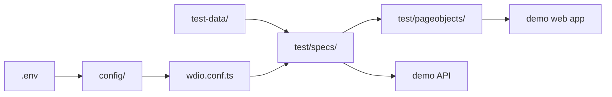

# Architecture

## Diagram



WebdriverIO 9 + TypeScript + Mocha end-to-end tests for
[the-internet.herokuapp.com](https://the-internet.herokuapp.com), using the
Page Object Model. One rule drives the layout: **no hard-coded runtime
values anywhere except the two places that own them** — `config/` owns
environment values, `test-data/` owns test values.

## Folder tree

```
webdriverio-test-automation/
├── wdio.conf.ts              # runner config (kept at root so `npx wdio` works)
├── config/
│   └── environments.ts       # base URL, timeouts, browser/capabilities, env overrides
├── test-data/
│   ├── login.json            # valid/invalid credentials, expected messages, pages
│   ├── checkboxes.json       # expected checkbox count and initial states
│   ├── dropdown.json         # dropdown options and placeholder value
│   └── search.json           # home search terms + expected matches, table filter values + expected rows
├── test/
│   ├── pageobjects/          # one class per page, selectors + actions only
│   │   ├── page.ts           # base page: open(), flash banner, heading
│   │   ├── login.page.ts     # /login
│   │   ├── secure.page.ts    # /secure
│   │   ├── checkbox.page.ts  # /checkboxes
│   │   ├── dropdown.page.ts  # /dropdown
│   │   ├── home.page.ts      # / (example list search, open a found example)
│   │   └── tables.page.ts    # /tables (filter Example 1 rows by column value)
│   └── specs/                # one spec file per page, assertions only
│       ├── login.spec.ts
│       ├── checkbox.spec.ts
│       ├── dropdown.spec.ts
│       └── search.spec.ts
├── docs/
│   ├── SETUP.md              # install + configuration
│   └── TESTING.md            # what is tested, how to run, reports
├── .env.example              # env var keys with safe defaults (copy to .env)
├── ARCHITECTURE.md           # this file
├── README.md
├── package.json
└── tsconfig.json
```

## Why each folder exists

| Folder / file | Purpose |
|---|---|
| `wdio.conf.ts` (root) | The wdio entry point. Kept at root so `npx wdio run wdio.conf.ts` and `npm test` work unchanged. It contains no literal values of its own — every setting is read from `config/environments.ts`. |
| `config/` | Runtime configuration. `environments.ts` is the single source of truth for base URL, timeouts, browser name, headless mode, window size, retry counts and log level. Values resolve as `process.env` > `.env` file > safe default. The `.env` file is parsed by a tiny built-in parser so the project needs no extra dependency. |
| `test-data/` | Test values as JSON, loaded by specs with `resolveJsonModule`. Login credentials (dummy demo account only), expected flash messages, expected pages, checkbox states and dropdown options live here so a data change never touches a spec. |
| `test/pageobjects/` | Page Object Model. Each class owns only its page's selectors and actions, plus its route path (`/login`, `/secure`, …). Page objects never contain test data, expected text, timeouts or the base URL — `Page.open()` resolves paths against the configured `baseUrl`. |
| `test/specs/` | Test cases. Each spec imports its page object(s) and its JSON test data, then asserts. Specs contain no credentials, URLs, timeouts or expected strings of their own. |
| `docs/` | Human docs: setup/configuration (`SETUP.md`) and what is tested plus how to run and report (`TESTING.md`). |
| `.env.example` | Documents every overridable setting with its default. Safe to commit; contains no real credentials. |

## Data flow

```
.env / process.env
      │
      ▼
config/environments.ts ──► wdio.conf.ts ──► WebdriverIO runner
      (baseUrl, timeouts,        (specs, capabilities,
       browser, headless)         reporters, mochaOpts)
                                      │
test-data/*.json ──► test/specs/*.ts ──┤
      (credentials, expected       ▼
       messages, option values)  test/pageobjects/*.ts
                                  (selectors, actions, routes)
                                      │
                                      ▼
                              browser (headless Chrome by default,
                              Firefox with BROWSER=firefox, both with
                              BROWSERS=chrome,firefox)
```

1. `config/environments.ts` resolves the runtime settings and hands
   them to `wdio.conf.ts`, which starts the runner.
2. A spec loads its JSON test data and drives its page object(s).
3. The page object performs actions against the browser; the base URL
   comes from the runner config, the route (`/login`, …) from the page
   object, the values from test data.
4. Assertions in the spec compare the browser state against the
   expected values from test data.

## How to add a new test

1. **Page object first** (if the page is new): add `test/pageobjects/<name>.page.ts`
   extending `Page`, with getters for the elements and methods for the
   actions. Only selectors, actions and the route path go here.
2. **Test data**: add the values the test needs to `test-data/<name>.json`
   (or extend an existing file). No literal credentials, messages or
   option values in the spec.
3. **Spec**: add `test/specs/<name>.spec.ts`, import the page object and
   the JSON, write `describe`/`it` blocks with `expect` assertions.
4. **Config** (only if the test needs a new setting): add the key to
   `config/environments.ts` with a safe default, document it in
   `.env.example` and `docs/SETUP.md`. Do not hard-code it in the spec.
5. Verify with `npm run typecheck`, then run the suite with `npm test`
   on a machine with Chrome.
