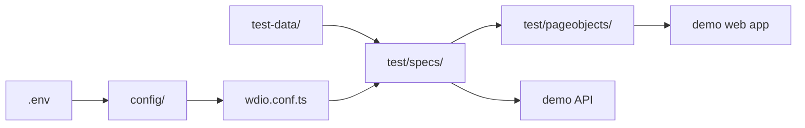

# webdriverio-test-automation

WebdriverIO (TypeScript) end-to-end tests for [the-internet.herokuapp.com](https://the-internet.herokuapp.com), a public demo site. Page Object Model, Mocha, spec + Allure reporting.

Config lives in `config/environments.ts` (base URL, timeouts, browser, env overrides) and test data in `test-data/` JSON files — no hard-coded URLs, credentials or timeouts in the page objects or specs. See [ARCHITECTURE.md](ARCHITECTURE.md) for the full layout and data flow.

## Stack

- WebdriverIO 9 (`@wdio/cli`, `@wdio/local-runner`, `@wdio/mocha-framework`)
- TypeScript + `ts-node` (async mode)
- No driver service: since WebdriverIO 8.14, the runner downloads and manages ChromeDriver automatically for the installed Chrome version. The old `@wdio/selenium-standalone-service` is deprecated and has no v9 release, so this project does not use it.
- Reporters: `spec` (console) + `allure`

## What is covered

| Spec | What it checks |
|---|---|
| `test/specs/login.spec.ts` (4 tests) | Valid login reaches the secure area; wrong password and wrong username show errors; logout returns to the login page |
| `test/specs/checkbox.spec.ts` (3 tests) | Both checkboxes shown with their starting state; clicking checks the first and unchecks the second |
| `test/specs/dropdown.spec.ts` (3 tests) | Dropdown shown with placeholder selected; selecting Option 1 and Option 2 |
| `test/specs/api-ui.spec.ts` (3 tests) | Combined API + UI: API call against JSONPlaceholder, then the matching UI flow (login, dropdown, login + logout) |
| `test/specs/search.spec.ts` (10 tests) | Search and filter: filter the home page example list by link text (including a no-match term), open a found example, and filter the data table rows by last name and by due amount |

23 tests total. Demo login used by the tests (shown on the site itself, stored in `test-data/login.json`): `tomsmith` / `SuperSecretPassword!` — dummy test credentials only.

## Install

```bash
npm install
```

Optional configuration — copy `.env.example` to `.env` and edit (all values have safe defaults in `config/environments.ts`):

```bash
cp .env.example .env
```

Full setup and every setting: [docs/SETUP.md](docs/SETUP.md).

## Run

```bash
npm test                  # full suite, headless Chrome
npm run test:headed       # full suite with a visible browser
npm run test:firefox      # full suite, headless Firefox
npm run test:all-browsers # full suite on Chrome then Firefox
npx wdio run wdio.conf.ts # same as npm test
```

Tests run in headless Chrome by default. You need Google Chrome installed on your machine; WebdriverIO downloads the matching ChromeDriver for you. To run on Firefox instead, install Mozilla Firefox and use `npm run test:firefox` (or `BROWSER=firefox npm test`); WebdriverIO downloads the matching GeckoDriver the same way. `BROWSERS=chrome,firefox` runs the suite on both browsers, one after the other.

## Reports

```bash
npm run test:report        # build the Allure report from allure-results/
npm run test:report:open   # open it in the browser
```

What is tested and how to run it: [docs/TESTING.md](docs/TESTING.md).

## Typecheck

```bash
npm run typecheck   # tsc --noEmit
```

## Project layout

```
wdio.conf.ts                 # runner config: reads everything from config/environments.ts
config/
  environments.ts            # base URL, timeouts, browser/capabilities, env overrides
test-data/
  login.json                 # valid/invalid credentials, expected messages, pages
  checkboxes.json            # expected checkbox count and initial states
  dropdown.json              # dropdown options and placeholder value
  api-ui.json                # API post id, expected user, new-post payload, dropdown option
  search.json                # home page search terms and expected matches, table filter values and expected rows
test/
  pageobjects/
    page.ts                  # base page: open(), flash banner, heading
    login.page.ts            # /login
    secure.page.ts           # /secure
    checkbox.page.ts         # /checkboxes
    dropdown.page.ts         # /dropdown
    home.page.ts             # / (example list search, open a found example)
    tables.page.ts           # /tables (filter Example 1 rows by column value)
  specs/
    login.spec.ts
    checkbox.spec.ts
    dropdown.spec.ts
    api-ui.spec.ts           # combined API + UI flow
    search.spec.ts           # search and filter (home list + data tables)
docs/
  SETUP.md                   # install + configuration
  TESTING.md                 # what is tested, how to run, reports
.env.example                 # env var keys with safe defaults
ARCHITECTURE.md              # folder tree, why each folder exists, data flow
```

## Status

Scaffold created 2026-11-18, rebuilt into the `config/` + `test-data/` structure 2026-11-20. Verified locally: `npm install` added 493 packages (WebdriverIO 9.33.1 resolved) and `npx tsc --noEmit` exits 0 with no errors. Browser tests have **not** been run yet — no Chrome is installed on the machine this was built on, so no test results are claimed here. Run `npm test` on a machine with Chrome (or `npm run test:firefox` on a machine with Firefox) to get the first real results, then update this section with the real numbers.

## Diagram


